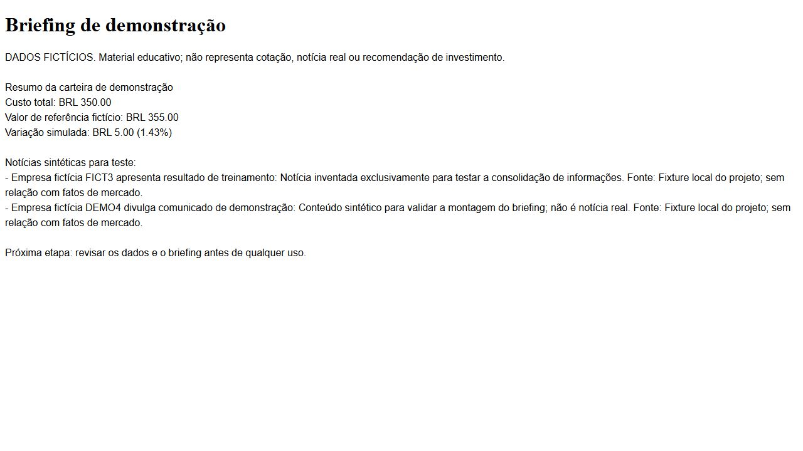

# RPA com n8n e Python: briefing educativo

MVP do projeto **Criando um Processo de RPA com N8N e Python**, da DIO. A automação consolida uma carteira fictícia, combina notícias sintéticas e prepara um briefing com arquivos de e-mail e HTML para revisão humana.

**[Repositório público](https://github.com/lucasestork/rpa-n8n-python)** · [Workflow principal](workflows/briefing-rpa.json) · [Evidências](docs/validacao.md)

## O que funciona

- Python calcula os totais e a variação da carteira usando Decimal.
- Uma API HTTP local entrega a análise, as notícias sintéticas e a geração do briefing.
- O n8n usa HTTP Request, Code e Merge para orquestrar o processo.
- O resultado é salvo em JSON, HTML e EML. O programa não possui envio SMTP.
- A repetição do mesmo contexto reutiliza os arquivos já gerados.
- O projeto contém 16 testes Python, incluindo API real local, validação, idempotência, escape de HTML e o contrato HTTP do adaptador Ollama com servidor falso.

**Modo demonstrativo:** texto produzido por template determinístico e dados inventados. Não usa um LLM, não consulta cotações ou notícias reais e não recomenda compra ou venda.

**Extensões opcionais:** [Ollama local](docs/ia-e-email.md) e [workflow com Gmail desabilitado](workflows/briefing-gmail-opcional.json). Não foram realizados geração com um modelo real nem envio de e-mail. A presença desses conectores não é apresentada como execução validada dessas integrações.

## Arquitetura

~~~mermaid
flowchart LR
  A[Início manual ou Webhook] --> B[Contexto demo]
  B --> C[HTTP: análise Python]
  B --> D[HTTP: notícias sintéticas]
  C --> E[Merge por posição]
  D --> E
  E --> F[Code: validar contexto]
  F --> G[HTTP: gerar briefing em Python]
  G --> H[Code: conferir resultado]
  H --> I[JSON + HTML + EML locais]
~~~

O Merge por posição funciona neste MVP porque cada ramo retorna exatamente um item: um objeto com a carteira e outro com a lista de notícias. Em outro formato de entrada, a estratégia de união precisa ser revista.

## Executar a parte Python

Requisito: Python 3.11 ou superior. A aplicação usa apenas a biblioteca padrão, sem instalação de pacotes Python.

~~~powershell
python -m unittest discover -s tests -v
python -m rpa demo --output outbox
~~~

Abra o arquivo .html gerado ou o .eml no seu leitor para revisar. Os endereços de e-mail pertencem ao domínio de exemplo example.com. Não há transmissão de mensagens.

## Executar o fluxo completo no n8n

Requisitos: Node.js compatível com a sua instalação e n8n já instalado. O teste do projeto usou **n8n 2.22.6**, encontrado no cache local. Essa é a versão validada nesta execução, não uma afirmação de que seja a versão mais recente.

1. No primeiro terminal, iniciar a API:

~~~powershell
python -m rpa serve --port 8765 --output outbox
~~~

2. No segundo terminal, executar o workflow:

~~~powershell
.\scripts\Test-N8n.ps1
~~~

O script procura n8n 2.22.6 no cache npm local. Se não encontrar, informe o caminho do arquivo JavaScript bin/n8n da sua instalação:

~~~powershell
.\scripts\Test-N8n.ps1 -N8nCliScript 'C:\caminho\node_modules\n8n\bin\n8n'
~~~

O executor importa somente o workflow principal em uma base separada em .runtime/n8n e o executa por ID. Ele não abre a base antiga do usuário e não redefine senhas. A pasta .runtime fica fora do Git e contém dados internos que não devem ser publicados.

Para importar na sua instalação existente, use o menu de importação de workflow e escolha workflows/briefing-rpa.json. Ajuste as URLs caso Python e n8n estejam em máquinas diferentes. O JSON é entregue inativo. Teste antes de publicar.

## Acionamento por webhook local

Com a API Python funcionando, execute:

~~~powershell
.\scripts\Start-N8n-Demo.ps1
~~~

Esse script publica somente o workflow principal na base isolada e inicia n8n em 127.0.0.1:5679. Em outro terminal:

~~~powershell
python scripts/acionar_webhook.py --url http://127.0.0.1:5679/webhook/rpa-briefing-demo
~~~

Encerre a demonstração com Ctrl+C no terminal do n8n. A URL de teste do editor usa /webhook-test/ e exige o modo de escuta de teste; a URL /webhook/ depende da publicação do fluxo.

## Evidência visual

O [registro do webhook](evidencias/webhook-local.json) mostra HTTP 200 e reutilização da saída, sem envio.

## Exemplo dos cálculos

| Item | Resultado da fixture |
| --- | ---: |
| Custo total | BRL 350.00 |
| Valor de referência fictício | BRL 355.00 |
| Variação absoluta simulada | BRL 5.00 |
| Variação percentual simulada | 1.43% |

O percentual é calculado sobre o custo da carteira; não é retorno de mercado nem previsão. Os arquivos em [exemplos](exemplos/) vieram da execução real do programa com essa fixture.

## Relação com as aulas

| Conteúdo exibido na DIO | Aplicação neste projeto |
| --- | --- |
| Assistentes de investimento | Briefing educativo com carteira fictícia |
| Colab, webhooks e n8n | Notebook Python opcional e acionador de webhook; execução completa validada localmente |
| HTTP + Code + Merge | Workflow principal com chamadas HTTP, validações e união dos ramos |
| Integração de IA | Adaptador opcional Ollama, com contrato testado por servidor falso |
| Briefing e e-mails | Geração local de HTML e EML para revisão |
| Gmail | Variante exportada com nó desabilitado, sem credenciais e sem execução de envio |

Esta é uma implementação própria orientada pelos tópicos visíveis na trilha, não uma cópia do código do instrutor. Os vídeos não foram integralmente transcritos ou reproduzidos durante esta implementação.

## Colab

[demo-colab.ipynb](demo-colab.ipynb) executa o modo Python. Foi entregue sem saídas pré-gravadas e não foi executado no ambiente Colab nesta sessão. O notebook não conecta automaticamente o localhost do Colab ao computador do usuário.

## Documentação e limites

- [Como validar e o que foi testado](docs/validacao.md).
- [IA e Gmail opcionais](docs/ia-e-email.md).
- [Contrato da API e tratamento de erros](docs/api.md).
- [Referências oficiais](docs/referencias.md).

A API liga apenas em loopback e foi criada para demonstração local. Não tem autenticação de aplicação nem foi preparada para acesso público. A reutilização de arquivos usa um lock no processo Python; não é coordenação entre várias instâncias. Os dados e os resultados são fictícios.

**Autoria:** lucasestork, com apoio de IA na implementação, testes e documentação.
